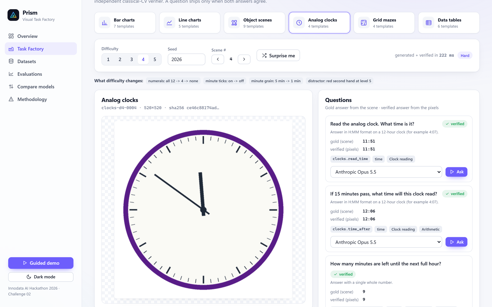

# Prism: Visual Task Factory

**Innodata AI Hackathon 2026 · Track 2: Visual Problem & Model Evaluation (Challenge 02: Visual Task Factory)**

**Team Vidyut** · Apratim Mitra (Team Leader), Goutam Kumar Bose, Dibyendu Chowdhury · https://github.com/teamvidyut2027/prism

Prism generates synthetic images and visual questions whose gold answers are verified twice, once from the scene and once from the rendered pixels. It then evaluates multimodal models and diagnoses where and *why* they fail.



> **Judges, one command (Docker):** `docker build -t prism . && docker run --rm prism python -m prism reproduce` rebuilds the benchmark from its seed, re-runs every validation layer and checks the result byte-for-byte against the committed fingerprint (PASS/FAIL per check).
>
> **Dashboard:** `docker run --rm -p 8000:8000 prism`, or without Docker `pip install -r requirements.txt && python -m prism build && python -m prism serve`, then open http://127.0.0.1:8000.
>
> **Guided demo for judges:** click **Guided demo** in the sidebar, or open http://127.0.0.1:8000/#/overview?tour=0. In 12 steps it drives the dashboard through generate → validate → ask Opus 5.5 live → variants → dataset → verifier audit → diagnosis → comparison, spotlighting the evidence and narrating each claim. Use ← → to move and Esc to exit; `?tour=N` deep-links to step N (counting from 0).

---

## The visual problem and why it matters

Teams are putting vision-language models to work **reading operational visuals**: charts in KPI dashboards and reports, tables in statements, analog gauges and dials on equipment, object layouts in inventory photos, and grid maps for routing. Before trusting a model with that job you need to know where its accuracy collapses, and whether its wrong answers come from misreading or from not looking at all. Public benchmarks can't tell you: their labels are partly hand-made, their difficulty can't be dialled, and they have no controlled counterfactuals.

Prism turns those image families into a **pre-deployment acceptance test**: verified tasks, a capability map by skill and difficulty, and named failure modes. On Anthropic Opus 5.5, for example, it shows charts are solved (100%), but a gauge-reading deployment should expect 1–3-minute errors on dials without numerals, and its maze "reachable" answers lean to *yes* when the goal is sealed off.

## Why Prism

AI models can describe pictures, read charts and answer visual questions. A synthetic benchmark is only useful if its labels are right and its tasks really need the image. Prism treats both as things to **prove**:

| Judging criterion | How Prism answers it |
|---|---|
| **Working implementation** (25%) | Full pipeline (factory → validation → evaluation → diagnosis) behind a CLI, a REST API and a React dashboard. 67 automated tests. |
| **Accuracy & validation** (25%) | Every gold answer is re-derived from pixels by an independent classical-CV verifier; disagreeing items are dropped. An audit injects label corruptions and the verifier catches **100%** of them. A pixel oracle scores **100%** through the same files, prompts and grader. |
| **Meaningful variation** (20%) | 6 task families, 35 question templates, 10 skills and 5 difficulty levels with real knobs. Every base task also gets **paraphrase, perturbation and counterfactual twins**, plus near-duplicate filtering, answer-balance stats and a blind-guess ceiling. |
| **Originality & engineering** (15%) | Two-path ground truth, verifier mutation-testing, counterfactual grounding metrics, seed-hierarchical determinism (byte-identical rebuilds), anti-aliasing-aware colour models and fixed-pitch template OCR. |
| **Practical impact & clarity** (15%) | One command to build a reproducible benchmark; plug in Opus 5.5 or any OpenAI-compatible VLM (Ollama, vLLM); every failure is inspectable with image, gold answer, model answer and parsed value. |

## How it works

```
seeded scene ──► ambiguity margins ──► render (deterministic) ──► re-render: byte-identical?
      │                                         │
      │ answer(template, params, facts)         │ pixel verifier (classical CV, sees only pixels + public layout)
      ▼                                         ▼
  gold answer  ══════════ must be equal ═══════ verified answer ──► ship, or reject and count the reason
                                                                        │
                       near-duplicate filter ◄──────────────────────────┘
                                  │
                                  ▼
        variants: paraphrase (same pixels) · perturbation (provably recoverable) · counterfactual (answer flips)
```

### Task families

| Family | What the image is | Questions (examples) | Verifier |
|---|---|---|---|
| **Bar charts** | vertical and horizontal bars, labels shown or hidden | tallest/shortest, value of X, how many above T, A − B, rank all | colour-coverage scan per bar slot, snapped to the value grain |
| **Line charts** | 1–3 series with legend | peak period, value at x, which series is higher, did it rise, count rises | alpha-blend model per series plus segment extrapolation at each tick |
| **Object scenes** | 4–19 coloured shapes | count by colour/shape/both, left-of/above, colour of leftmost, largest shape, commonest colour | exclusive colour coverage, connected components, solidity/fill shape classifier |
| **Analog clocks** | numerals → bare dial, distractor second hand | read the time, minutes to the hour, time after k minutes, minute-hand numeral | radial ray profiles separating minute and hour hands by length |
| **Grid mazes** | 5×5 → 12×12 walls, start and goal | reachable?, shortest path length, first move, walls in row k | cell sampling plus marker localisation, then an independent BFS |
| **Data tables** | 3–10 rows of integers | lookup, column max/min, column sum, rows where A > B, reverse lookup | fixed-pitch template OCR with sub-pixel and blur-matched templates |

Difficulty (L1–L5) turns real knobs: number of elements, separation margins (10% → 4% of the axis), hidden value labels, numerals removed, finer minute grain, grid size, font size and distractors.

### Validation, layer by layer

1. **Ambiguity is designed out**: unique extremes by a margin, thresholds never near a value, non-overlapping objects, clock hands ≥ 20° apart, unique first move, and a colour palette whose closest pair is ΔE 28 apart.
2. **Two-path ground truth**: `answer()` runs on the scene facts *and* on the facts the verifier measured from pixels. A question ships only if both agree.
3. **Determinism**: every task is re-rendered and compared byte-for-byte; the whole dataset is a pure function of `(seed, family, level, index, attempt)`.
4. **Verifier audit** (`python -m prism verify`): agreement on fresh scenes plus a **label-corruption test**. It renders a minimally edited scene, claims the original labels, and checks that the verifier objects.
5. **Pipeline integrity**: the pixel oracle answers every item through the same PNG files, prompts and grader and must score 100%.
6. **Diversity and bias**: a 256-bit perceptual-hash near-duplicate filter, exact-content dedupe, per-template answer entropy, balanced yes/no answers, and a reported blind-guess ceiling.

### Diagnostics for models

* Accuracy with 95% Wilson intervals by family, level, skill, template, answer type and variant.
* **Consistency**: the same answer to a paraphrase of the same image.
* **Robustness**: accuracy and flip rate under noise, blur, JPEG and downscaling. These variants are only admitted if the verifier still recovers the facts, so a failure is the model's fault.
* **Grounding**: right on both sides of a counterfactual pair. **Stuck rate**: the same answer though the truth changed, which flags answers that don't come from the image.
* Error magnitude (e.g. minutes off on clocks), calibration (ECE, Brier, reliability diagram), cost and latency.

## Results

### The benchmark: `prism-core` (seed 2026, 8 scenes per family × level)

| | |
|---|---|
| Base scenes / tasks incl. variants / questions | **237 / 910 / 1,747** |
| Gold answers cross-checked against pixels | **100%** |
| Variants | 237 paraphrase · 203 perturbation · 233 counterfactual |
| Templates / skills / families / levels | 35 / 10 / 6 / 5 |
| Yes/no balance | 51.8% "yes" |
| Blind-guess ceiling (majority answer per template) | 24.7% |
| Build time (8 cores) | ~30 s |

### Validation audit: `python -m prism verify --n 40` (1,173 fresh scenes)

| Family | Scenes | Verifier agreement | Corruptions caught | Recovery: noise / blur / JPEG / downscale |
|---|---:|---:|---:|---|
| Bar charts | 200 | 100.0% | 100% (200) | 78% / 84% / 84% / 100% |
| Line charts | 200 | 98.5% | 100% (200) | 86% / 72% / 14% / 90% |
| Object scenes | 200 | 100.0% | 100% (200) | 100% / 78% / 76% / 100% |
| Analog clocks | 174 | 100.0% | 100% (174) | 98% / 100% / 100% / 100% |
| Grid mazes | 199 | 100.0% | 100% (199) | 80% / 100% / 100% / 100% |
| Data tables | 200 | 100.0% | 100% (200) | 78% / 34% / 66% / 38% |
| **All** | **1,173** | **99.74%** | **100% (1,173)** | |

Determinism is 100%: every scene re-renders byte-identically. Where the verifier disagrees (for example a line hidden where two series cross), the factory rejects the scene. Perturbation twins are only admitted when recovery succeeds, which is why lines get few JPEG twins and tables few blur twins.

### Reference models on `prism-core`

| Model | Dataset | Items | Accuracy (95% CI) | Consistency | Perturbed acc. | Grounded | Stuck |
|---|---|---:|---|---:|---:|---:|---:|
| Pixel oracle (classical CV, integrity check) | prism-core | 1747 | **100.0%** (99.8%-100.0%) | 100.0% | 100.0% | 100.0% | 0.0% |
| **Anthropic Opus 5.5** | prism-core | 1747 | **95.2%** (94.1%-96.1%) | 94.5% | 96.4% | 90.6% | 2.6% |
| Blind prior (majority answer) | prism-core | 1747 | **25.0%** (23.0%-27.1%) | 88.2% | 27.0% | 0.0% | 90.6% |
| Blind random guess | prism-core | 1747 | **18.7%** (16.9%-20.6%) | 19.8% | 19.9% | 4.3% | 11.6% |

Each row is one model run over all 1,747 items. The pixel oracle proves the pipeline is leak-free and the grader is correct. The blind prior shows the value of counterfactual pairs: 0% grounded and ~91% stuck, because a model that does not look gives the same answer to both images.

### What the factory revealed about Anthropic Opus 5.5

The full run cost $7.28 (1.40M input and 84k output tokens, p50 latency 1.5 s, 0 errors). Every failure below was audited: the grader parsed each answer correctly, and the gold answers were spot-checked by hand.

| Finding | Evidence |
|---|---|
| **Analog clocks are the weakest skill** (86.2%) | `read_time` scores 74.2%, falling to 75% at level 4 (no numerals). Most misses are **1–3 minutes off**, so Opus 5.5 locates the hands but not their exact angle. |
| **Systematic optimism on maze reachability** | All 13 `reachable` errors are the same mistake: Opus 5.5 answers *yes* when the goal is sealed off by walls (one case was checked by hand). Shortest-path counts are off by about 2 steps (`shortest` 85.7%). |
| **Row-wise table comparison breaks at scale** | `tables.count_gt` scores 68.3%, while plain cell lookup is perfect. Tables drop from 100% at L1–L3 to ~85% at L4–L5 (7–10 rows). |
| **Counting holds until clutter** | Object scenes are 100% at L1–L4 and 91% at L5 (14–19 objects); `count_total` is the hardest object template (89.4%). |
| **Chart reading is solved** | Bars and lines are 100% at every level; numeric reading and trend analysis are 100%. |
| **Robust and grounded** | Perturbed accuracy (96.4%) is no lower than clean, with a 1.8% flip rate. Opus 5.5 is right on both sides of 90.6% of counterfactual pairs and "stuck" on only 2.6% (blind prior: 90.6%). |
| **Well calibrated** | Expected calibration error is 0.028 and the Brier score 0.039; mean stated confidence is 93% against 95% actual accuracy. |

## Quick start

### With Docker (recommended for judging)

```bash
docker build -t prism .
docker run --rm prism python -m prism reproduce            # rebuild + validate + fingerprint check (~5 min)
docker run --rm prism python -m pytest -q                  # 67 tests, offline
docker run --rm -p 8000:8000 prism                         # dashboard at http://127.0.0.1:8000 (builds prism-core on first start)
docker run --rm -e ANTHROPIC_API_KEY=sk-ant-... prism \
  python -m prism eval --model anthropic:opus-5-5 --base-per-family 5    # optional: live Opus 5.5 run
```

or `docker compose up --build` (reads `ANTHROPIC_API_KEY` from your environment and keeps data in a volume).

### Without Docker (Python 3.11+)

```bash
pip install -r requirements.txt

python -m prism build --name prism-core --per-cell 8     # ~25 s on 8 cores
python -m prism verify --n 40                           # verifier audit -> docs/evidence/verifier_audit.json
python -m prism eval --dataset prism-core --model oracle:pixels
python -m prism eval --dataset prism-core --model baseline:prior
python -m prism serve                                   # http://127.0.0.1:8000
python -m pytest -q                                     # 67 tests, offline
```

Evaluate Opus 5.5 (put `ANTHROPIC_API_KEY` in `.env`, see `.env.example`):

```bash
python -m prism eval --dataset prism-core --model anthropic:opus-5-5 --base-per-family 20
```

Evaluate a local open-weight VLM through any OpenAI-compatible server:

```bash
set PRISM_OPENAI_BASE_URL=http://localhost:11434/v1
set PRISM_OPENAI_MODEL=qwen2.5vl:7b
python -m prism eval --dataset prism-core --model openai-compat:qwen2.5vl:7b
```

The dashboard is prebuilt into `prism/static`. To work on the front-end: `cd web && npm install && npm run dev` (proxies `/api` to port 8000), then `npm run build`.

## Submission materials

| Deliverable (participant guide) | Where |
|---|---|
| Runnable source code + setup | this README, `Dockerfile`, `requirements.txt` (exact pins) |
| Generated tasks + model findings | `data/datasets/prism-sample/`, `docs/samples/README.md`, [results above](#results), `docs/evidence/RESULTS.md` |
| Validation evidence | `docs/evidence/`: verifier audit (mutation testing), `logs/reproduce.log` (Windows) and `logs/reproduce_docker.log` (Linux container), both byte-identical, `logs/pytest.log`, `logs/opus-5-5_report.txt`, run metrics in `runs/*.json`, failure cases in `FAILURES.md`, development fixes in `FIXES.md`, dataset fingerprint |
| Technical explanation | `docs/TECHNICAL.md` (design, assumptions, reused components, model and tool declaration, variation strategy) |
| Walkthrough demo | the in-app **Guided demo** (12 steps, live model call) and the walkthrough video submitted with the entry |

**AI tools declared:** Anthropic Opus 5.5 and Anthropic Haiku 5.5 are the models under evaluation, and Anthropic's AI coding assistant was used as a development assistant. No model is used inside the task factory: generation, verification and grading are deterministic code.

## Project layout

```
prism/
  core/        spec (Task, Question), seeded RNG, palette and colour models, deterministic renderer
  families/    bars, lines, shapes, clocks, mazes, tables: generator + renderer + answer() + pixel verifier
  validate/    perturbations with recoverability check, verifier audit (agreement + corruption detection)
  pipeline/    factory (rejection funnel, variants, dedupe), stats, evaluation runner, metrics
  grading/     format-tolerant, meaning-strict answer parsing
  models/      Opus 5.5 (vision, structured output), OpenAI-compatible VLMs, blind baselines, pixel oracle
  server.py    FastAPI API + SPA hosting
  __main__.py  CLI: build | verify | eval | report | serve
web/           React + TypeScript dashboard (Vite), built into prism/static
tests/         67 tests: verifier recovery, determinism, corruption detection, grading, end-to-end API
docs/          evidence (audit, logs, failures, fixes, fingerprint), samples, screenshots, technical write-up
scripts/       failure_report.py (FAILURES.md), dataset_digest.py (cross-platform diff)
Dockerfile     runtime image; docker-entrypoint.sh builds prism-core on first start
```

## Dataset format

`data/datasets/<name>/tasks.jsonl` has one task per line:

```json
{"task_id": "clocks-d4-0003", "family": "clocks", "difficulty": 4, "variant": "base",
 "image_id": "clocks-d4-0003", "image_sha256": "…",
 "questions": [{"qid": "clocks-d4-0003:q0", "template": "clocks.read_time",
                "text": "What time does the clock show?", "answer_type": "time",
                "answer": "7:43", "verified_answer": "7:43", "verified": true,
                "skills": ["clock_reading"]}],
 "scene": {…ground truth…}, "manifest": {…public layout, no answers…}}
```

Images are in `images/<image_id>.png`, and `dataset.json` holds the config, the rejection funnel and the statistics. A `README.md` dataset card is written next to them.

## License

Code: MIT. Fonts: DejaVu (Bitstream Vera license, bundled in `prism/assets/fonts`).
