# Failure cases: Anthropic Opus 5.5 on `prism-core`

84 of 1747 answers were wrong (4.8%). Every failure below was graded by the same parser that gives the pixel oracle 100%, and the parsed value is shown so each grading decision can be audited.

## Failures by template

| Template | Wrong / asked | Accuracy | Typical error |
|---|---:|---:|---|
| `clocks.read_time` | 25 / 97 | 74.2% | off by 1 min (median of misses), max 29 min |
| `mazes.reachable` | 13 / 92 | 85.9% | 13/13 said *yes* when the goal is unreachable |
| `tables.count_gt` | 13 / 41 | 68.3% | off by 1 (median of misses), max 1 |
| `clocks.minutes_to_hour` | 9 / 85 | 89.4% | off by 1 min (median of misses), max 2 min |
| `clocks.time_after` | 8 / 76 | 89.5% | off by 19 min (median of misses), max 61 min |
| `mazes.shortest` | 7 / 49 | 85.7% | off by 2 (median of misses), max 2 |
| `shapes.count_total` | 5 / 47 | 89.4% | off by 1 (median of misses), max 1 |
| `mazes.row_walls` | 3 / 106 | 97.2% | off by 1 (median of misses), max 1 |
| `tables.col_sum` | 1 / 40 | 97.5% | off by 282 (median of misses), max 282 |

## Examples

### `clocks.read_time`

**clocks-d1-0002-pert** (level 1, perturbation)  
*What time does the clock show?*  
gold **7:25** · model said `7:54` (parsed 7:54) · confidence 0.60

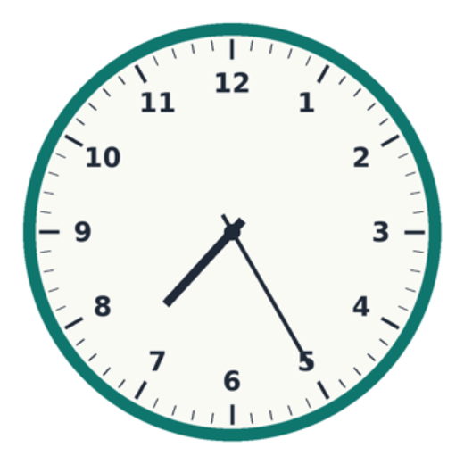

**clocks-d1-0002** (level 1, base)  
*What time does the clock show?*  
gold **7:25** · model said `7:26` (parsed 7:26) · confidence 0.60

### `mazes.reachable`

**mazes-d1-0000-pert** (level 1, perturbation)  
*Moving only up, down, left or right through white cells, can the green circle reach the red square?*  
gold **no** · model said `yes` (parsed yes) · confidence 0.97

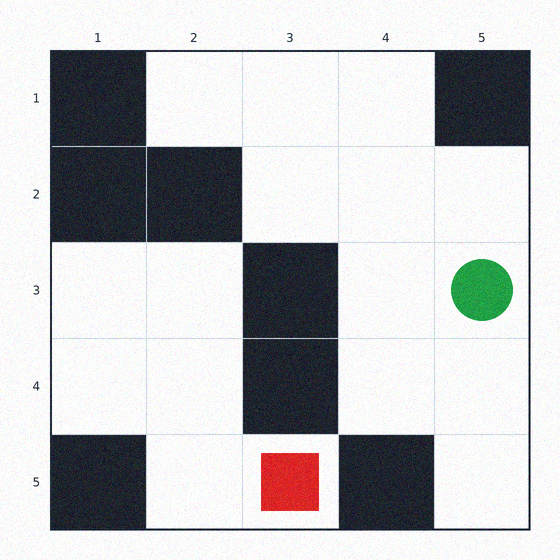

**mazes-d1-0000** (level 1, base)  
*Moving only up, down, left or right through white cells, can the green circle reach the red square?*  
gold **no** · model said `yes` (parsed yes) · confidence 0.97

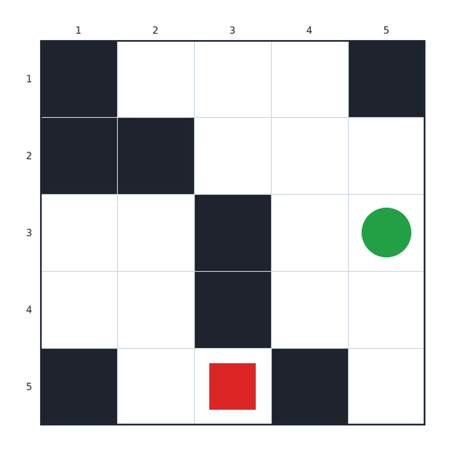

### `tables.count_gt`

**tables-d4-0001-para** (level 4, paraphrase)  
*For how many products is Q3 greater than Q2?*  
gold **4** · model said `5` (parsed 5) · confidence 0.95

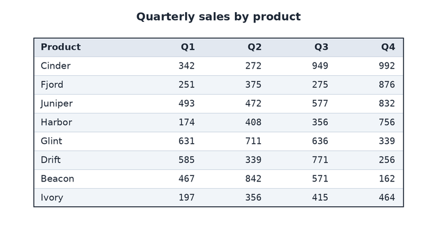

**tables-d4-0001-pert** (level 4, perturbation)  
*Count the rows where the Q3 value exceeds the Q2 value.*  
gold **4** · model said `5` (parsed 5) · confidence 0.95

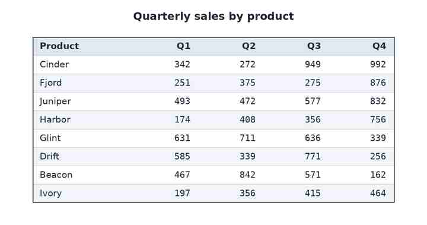

### `clocks.minutes_to_hour`

**clocks-d1-0002** (level 1, base)  
*How many minutes are left until the next full hour?*  
gold **35** · model said `34` (parsed 34) · confidence 0.60

**clocks-d1-0003-pert** (level 1, perturbation)  
*How many minutes are left until the next full hour?*  
gold **10** · model said `11` (parsed 11) · confidence 0.60

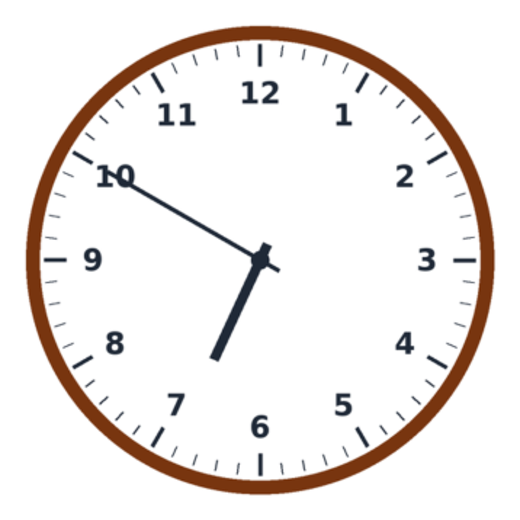

### `clocks.time_after`

**clocks-d2-0007** (level 2, base)  
*If 90 minutes pass, what time will this clock read?*  
gold **7:55** · model said `8:24` (parsed 8:24) · confidence 0.60

**clocks-d3-0007** (level 3, base)  
*What time will the clock show 40 minutes from now?*  
gold **11:22** · model said `11:28` (parsed 11:28) · confidence 0.80

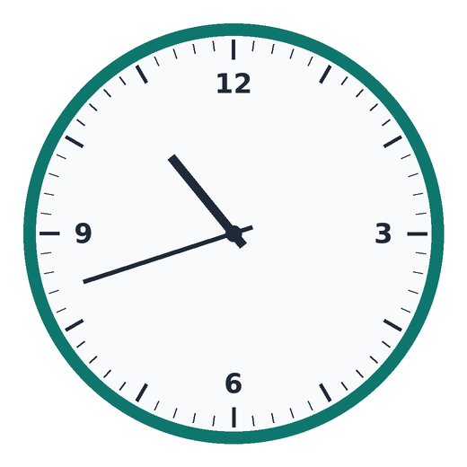

### `mazes.shortest`

**mazes-d2-0003-pert** (level 2, perturbation)  
*Count the steps on the shortest path from the green circle to the red square (4-directional moves, walls are black).*  
gold **6** · model said `7` (parsed 7) · confidence 0.92

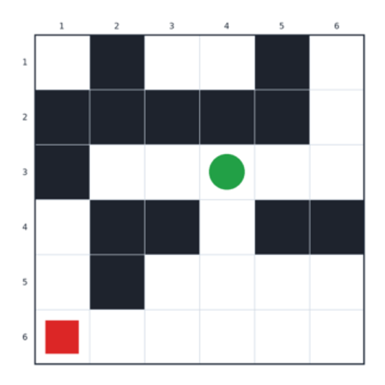

**mazes-d2-0007-cf** (level 2, counterfactual)  
*Count the steps on the shortest path from the green circle to the red square (4-directional moves, walls are black).*  
gold **7** · model said `5` (parsed 5) · confidence 0.88

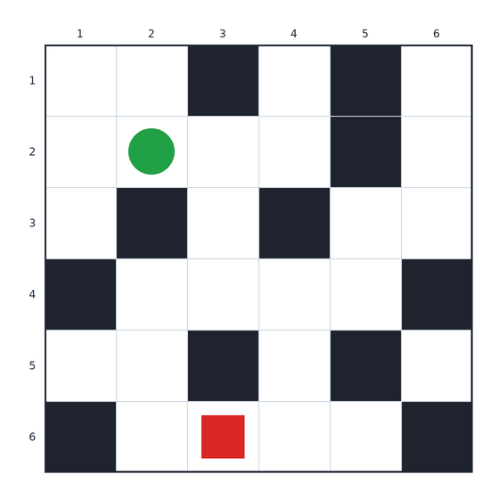

### `shapes.count_total`

**shapes-d5-0000** (level 5, base)  
*How many shapes are there in total?*  
gold **19** · model said `20` (parsed 20) · confidence 0.88

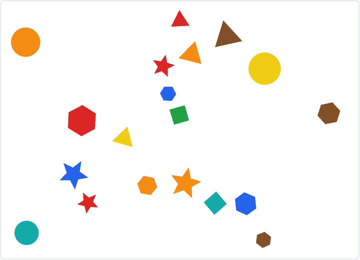

**shapes-d5-0002** (level 5, base)  
*Count every object in the image.*  
gold **19** · model said `20` (parsed 20) · confidence 0.88

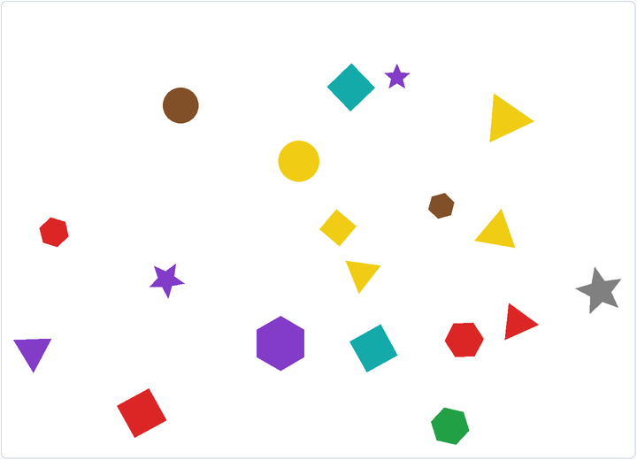

### `mazes.row_walls`

**mazes-d5-0003-cf** (level 5, counterfactual)  
*How many black wall cells are in row 5 (rows are numbered from 1 at the top)?*  
gold **6** · model said `7` (parsed 7) · confidence 0.92

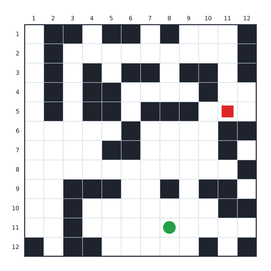

**mazes-d5-0003-pert** (level 5, perturbation)  
*How many black wall cells are in row 5 (rows are numbered from 1 at the top)?*  
gold **5** · model said `6` (parsed 6) · confidence 0.88

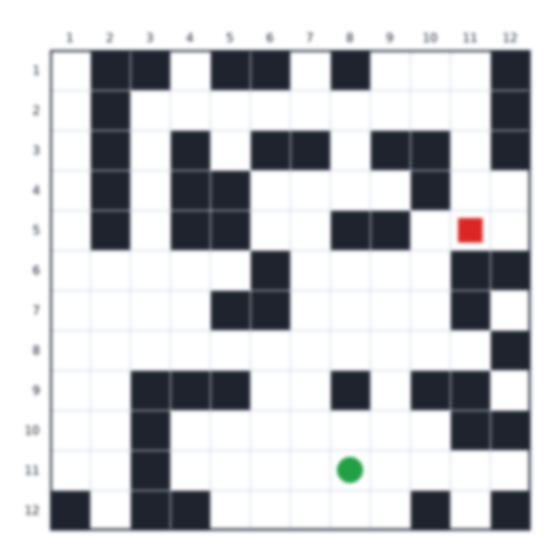

### `tables.col_sum`

**tables-d4-0005-cf** (level 4, counterfactual)  
*What is the sum of all values in the Math column?*  
gold **4851** · model said `5133` (parsed 5133) · confidence 0.97

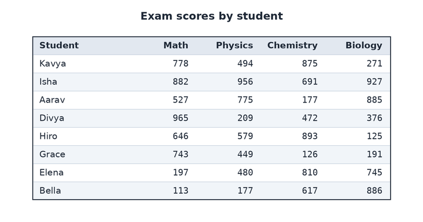
