# Sample outputs

Generated with `python -m prism build --name prism-sample --per-cell 1 --seed 42`.
Every gold answer below was reproduced independently from the pixels (`verified`).

## bars

### `bars-d2-0000` (level 2)

| Question | Gold (scene) | Verified (pixels) | Skills |
|---|---|---|---|
| Count the bars whose value is above 120. | **1** | 1 | counting, comparison, numeric_reading |
| Is the visitor count of Acropolis greater than the visitor count of Hermitage? | **yes** | yes | comparison |
| By how much does the visitor count of Acropolis exceed that of Prado? | **50** | 50 | numeric_reading, text_reading, arithmetic |

Counterfactual twin: *Count the bars whose value is above 120.* answer **1 -> 2**

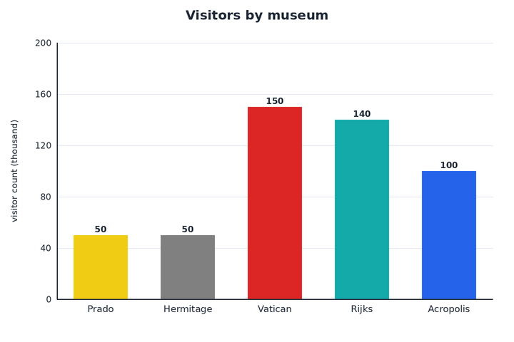

Perturbation twin (blur, strength 0.4), answer still recoverable from pixels:

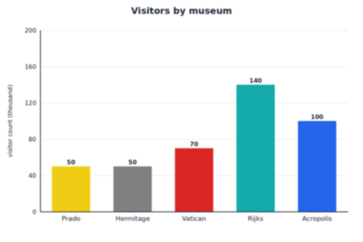

### `bars-d4-0000` (level 4)

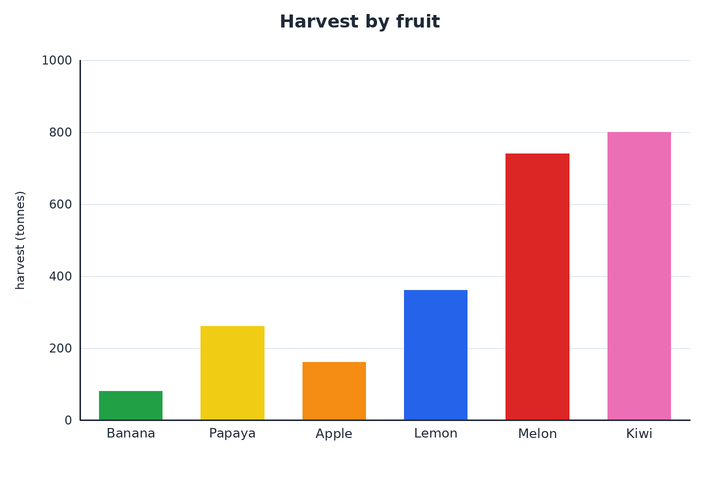

| Question | Gold (scene) | Verified (pixels) | Skills |
|---|---|---|---|
| Order the bars by value, largest first, giving the fruit names. | **Kiwi, Melon, Lemon, Papaya, Apple, Banana** | Kiwi, Melon, Lemon, Papaya, Apple, Banana | comparison |
| Which fruit has the lowest harvest? | **Banana** | Banana | comparison |
| What is the harvest of Melon? | **740** | 740 | numeric_reading |

Counterfactual twin: *What is the harvest of Melon?* answer **740 -> 600**

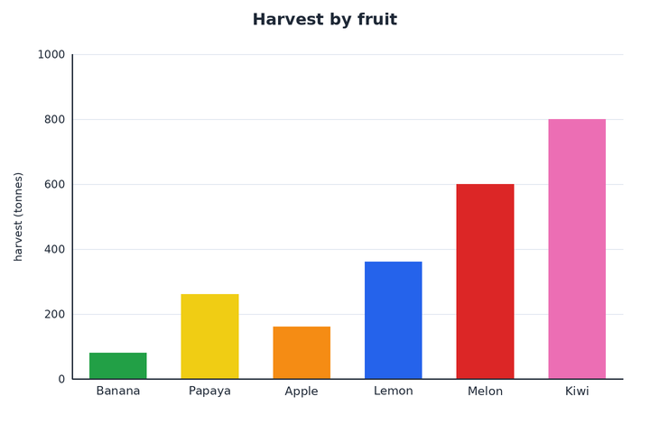

Perturbation twin (downscale, strength 0.8), answer still recoverable from pixels:

## lines

### `lines-d2-0000` (level 2)

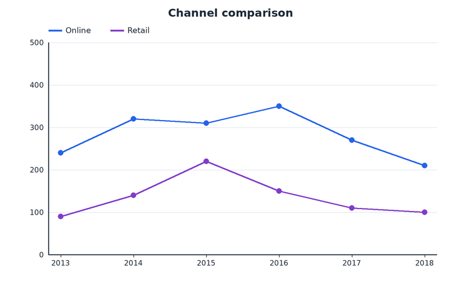

| Question | Gold (scene) | Verified (pixels) | Skills |
|---|---|---|---|
| Read the chart: what does Retail show for 2013? | **90** | 90 | numeric_reading, attribute_binding |
| At 2016, which series has the higher value: Online or Retail? | **Online** | Online | comparison, attribute_binding |
| Is the value of Online at 2018 higher than at 2015? | **no** | no | trend_analysis, attribute_binding |

Counterfactual twin: *At 2016, which series has the higher value: Online or Retail?* answer **Online -> Retail**

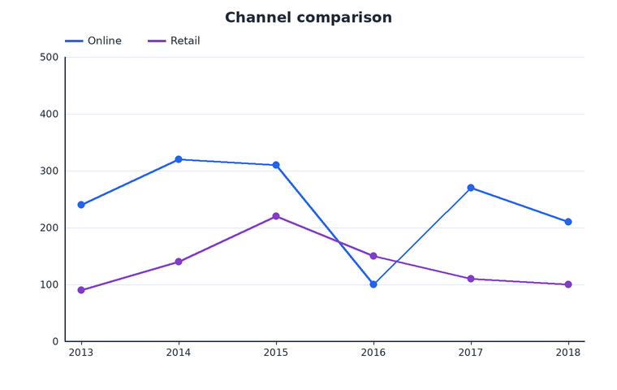

Perturbation twin (noise, strength 0.4), answer still recoverable from pixels:

### `lines-d4-0000` (level 4)

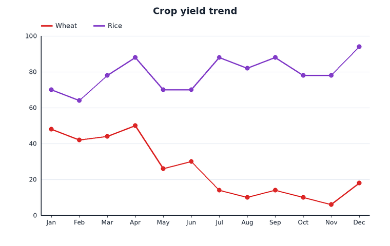

| Question | Gold (scene) | Verified (pixels) | Skills |
|---|---|---|---|
| Did Rice increase from Feb to Nov? | **yes** | yes | trend_analysis, attribute_binding |
| Which is higher at Dec, Wheat or Rice? | **Rice** | Rice | comparison, attribute_binding |
| Read the chart: what does Rice show for Jan? | **70** | 70 | numeric_reading, attribute_binding |

Counterfactual twin: *Did Rice increase from Feb to Nov?* answer **yes -> no**

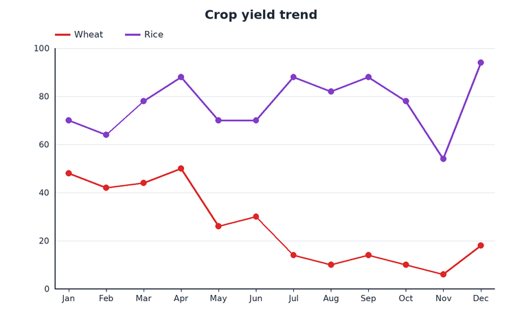

## shapes

### `shapes-d2-0000` (level 2)

| Question | Gold (scene) | Verified (pixels) | Skills |
|---|---|---|---|
| How many shapes are there in total? | **6** | 6 | counting |
| Is the brown square positioned higher than the red hexagon? | **no** | no | spatial_reasoning, attribute_binding |
| What type of shape is the largest object? | **hexagon** | hexagon | comparison |

Counterfactual twin: *What type of shape is the largest object?* answer **hexagon -> square**

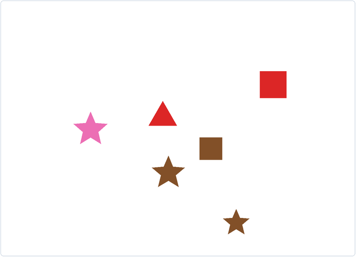

Perturbation twin (downscale, strength 0.4), answer still recoverable from pixels:

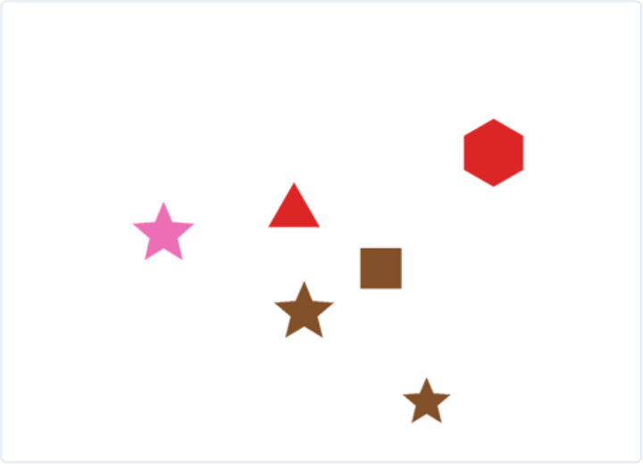

### `shapes-d4-0000` (level 4)

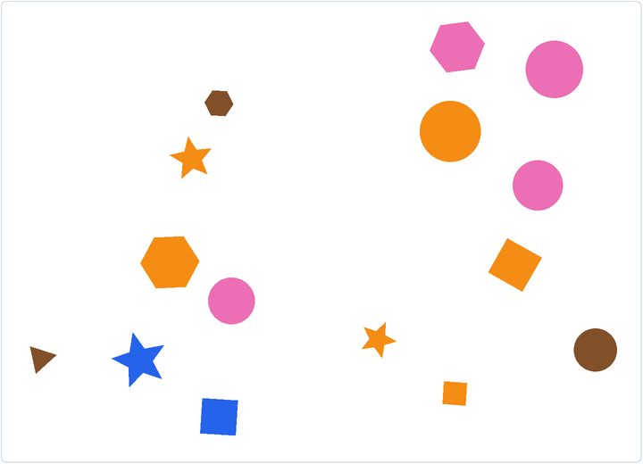

| Question | Gold (scene) | Verified (pixels) | Skills |
|---|---|---|---|
| Count every object in the image. | **15** | 15 | counting |
| What is the most frequent object colour? | **orange** | orange | counting, comparison, attribute_binding |
| Is the blue square positioned higher than the orange hexagon? | **no** | no | spatial_reasoning, attribute_binding |

Counterfactual twin: *Count every object in the image.* answer **15 -> 14**

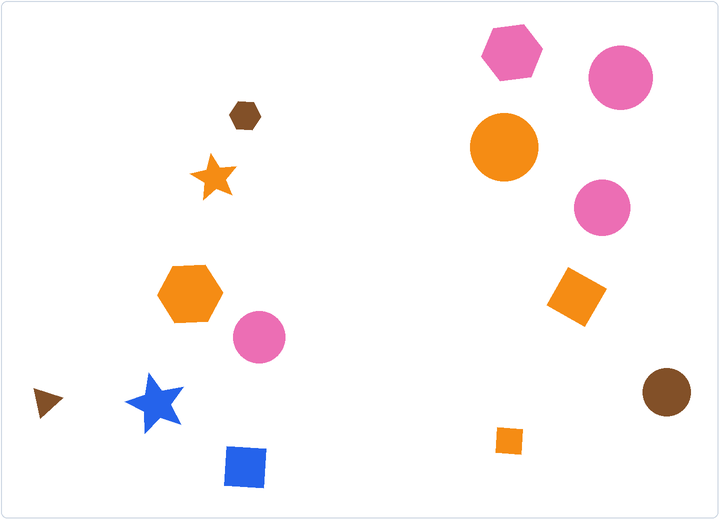

Perturbation twin (jpeg, strength 0.8), answer still recoverable from pixels:

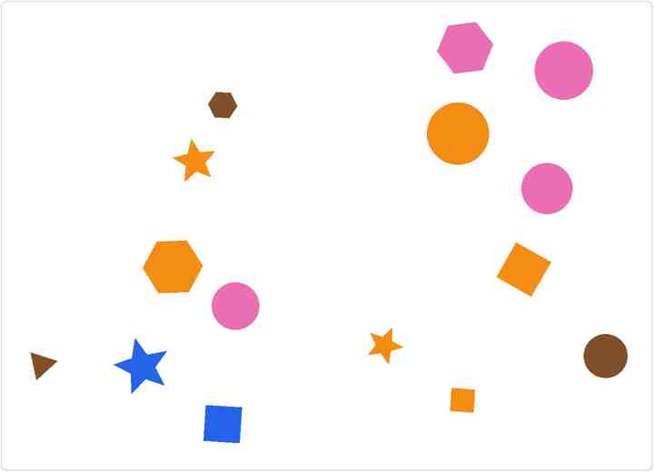

## clocks

### `clocks-d2-0000` (level 2)

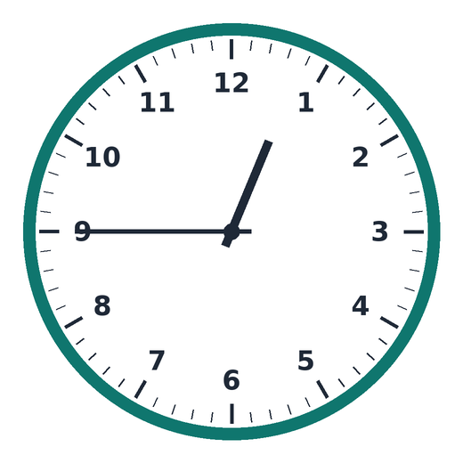

| Question | Gold (scene) | Verified (pixels) | Skills |
|---|---|---|---|
| Which numeral (1-12) is the minute hand pointing at? | **9** | 9 | clock_reading, spatial_reasoning |
| How many minutes are left until the next full hour? | **15** | 15 | clock_reading, arithmetic |
| Read the analog clock. What time is it? | **12:45** | 12:45 | clock_reading |

Counterfactual twin: *How many minutes are left until the next full hour?* answer **15 -> 30**

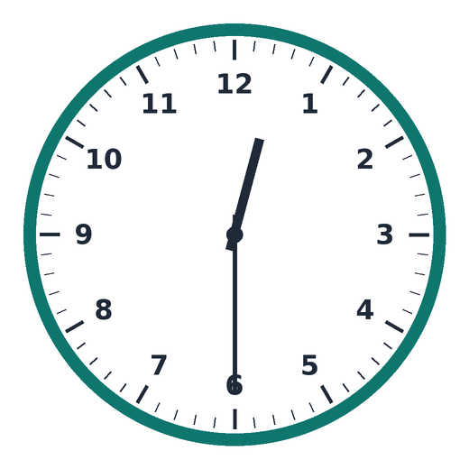

Perturbation twin (blur, strength 0.4), answer still recoverable from pixels:

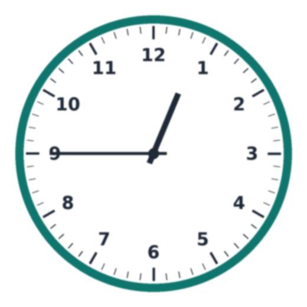

### `clocks-d4-0000` (level 4)

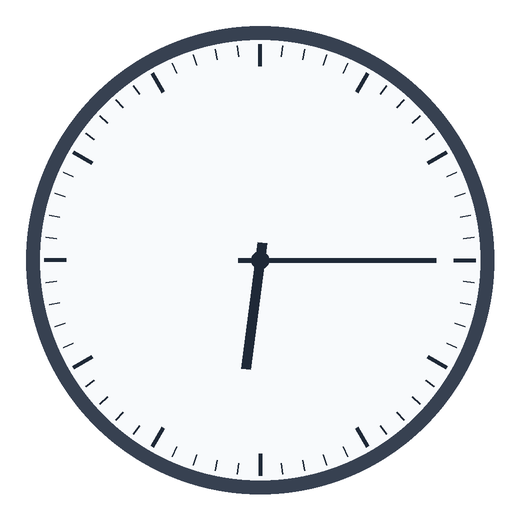

| Question | Gold (scene) | Verified (pixels) | Skills |
|---|---|---|---|
| Read the analog clock. What time is it? | **6:15** | 6:15 | clock_reading |
| What time will the clock show 45 minutes from now? | **7:00** | 7:00 | clock_reading, arithmetic |
| The minute hand points at which hour mark (1-12)? | **3** | 3 | clock_reading, spatial_reasoning |

Counterfactual twin: *What time will the clock show 45 minutes from now?* answer **7:00 -> 7:45**

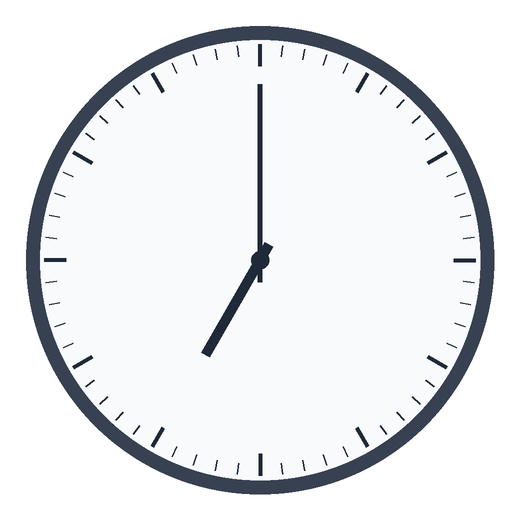

Perturbation twin (downscale, strength 0.8), answer still recoverable from pixels:

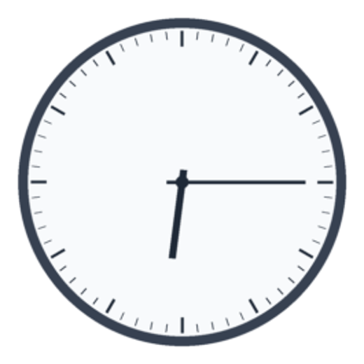

## mazes

### `mazes-d2-0000` (level 2)

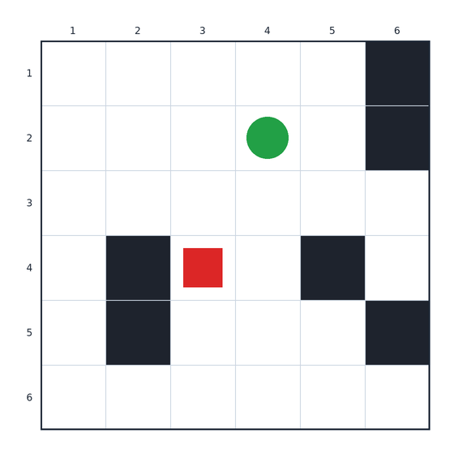

| Question | Gold (scene) | Verified (pixels) | Skills |
|---|---|---|---|
| Count the steps on the shortest path from the green circle to the red square (4-directional moves, walls are black). | **3** | 3 | path_reasoning, counting |
| Is there a path of white cells (no diagonal moves) from the green circle to the red square? | **yes** | yes | path_reasoning |
| How many black wall cells are in row 5 (rows are numbered from 1 at the top)? | **2** | 2 | counting, spatial_reasoning |

Counterfactual twin: *How many black wall cells are in row 5 (rows are numbered from 1 at the top)?* answer **2 -> 3**

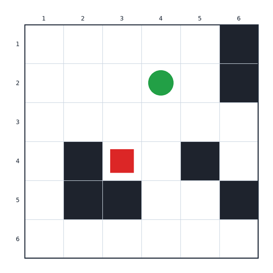

Perturbation twin (noise, strength 0.4), answer still recoverable from pixels:

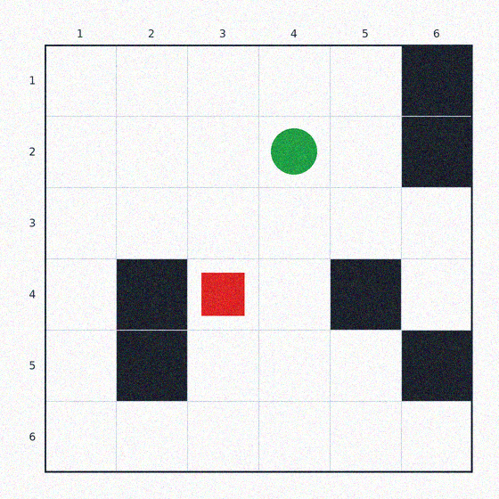

### `mazes-d4-0000` (level 4)

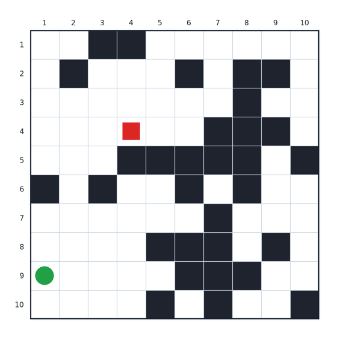

| Question | Gold (scene) | Verified (pixels) | Skills |
|---|---|---|---|
| What is the minimum number of moves needed to go from the green circle to the red square? Each move goes one cell up, down, left or right, and black cells are walls. | **8** | 8 | path_reasoning, counting |
| Moving only up, down, left or right through white cells, can the green circle reach the red square? | **yes** | yes | path_reasoning |
| Count the black cells in row 5, where row 1 is the top row. | **6** | 6 | counting, spatial_reasoning |

Counterfactual twin: *Count the black cells in row 5, where row 1 is the top row.* answer **6 -> 5**

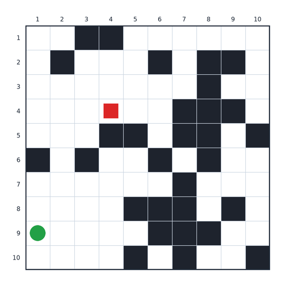

Perturbation twin (jpeg, strength 0.8), answer still recoverable from pixels:

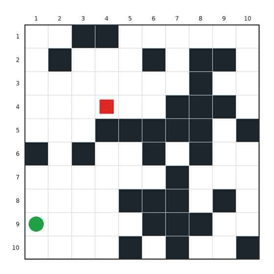

## tables

### `tables-d2-0000` (level 2)

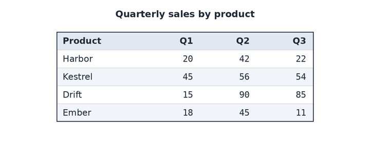

| Question | Gold (scene) | Verified (pixels) | Skills |
|---|---|---|---|
| Which product has a Q3 value of exactly 54? | **Kestrel** | Kestrel | text_reading |
| For how many products is Q2 greater than Q3? | **4** | 4 | text_reading, comparison, counting |
| In the Q1 column, which product has the largest number? | **Kestrel** | Kestrel | text_reading, comparison |

Counterfactual twin: *For how many products is Q2 greater than Q3?* answer **4 -> 3**

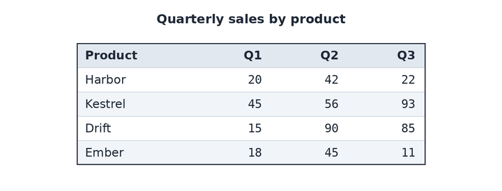

Perturbation twin (downscale, strength 0.4), answer still recoverable from pixels:

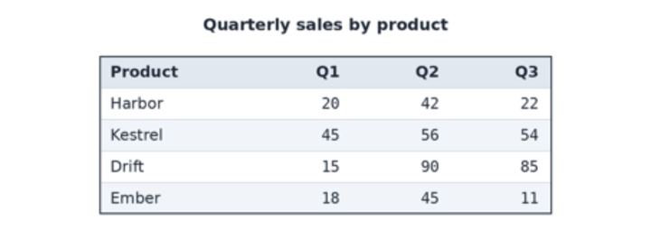

### `tables-d4-0000` (level 4)

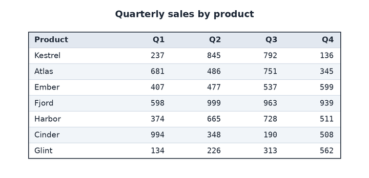

| Question | Gold (scene) | Verified (pixels) | Skills |
|---|---|---|---|
| Find the cell in row Fjord, column Q2. What number is there? | **999** | 999 | text_reading |
| Whose Q4 entry is 939? | **Fjord** | Fjord | text_reading |
| Which product has the highest Q4 value? | **Fjord** | Fjord | text_reading, comparison |

Counterfactual twin: *Which product has the highest Q4 value?* answer **Fjord -> Ember**

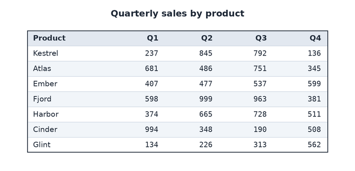
